# Web Structure Mining — Slide Ringkas

> Dikonversi otomatis dari `resource/Web-Mining/Webstructure minig.pptx`.
> Total 50 slide. Untuk detail aslinya baca file sumber .pptx.

## Slide 1: WEB STRUCTURE MINING

**Isi slide:**

- WEB STRUCTURE MINING

## Slide 2: Garis Besar Bab

**Isi slide:**

- 1.
- Mendeskripsikan Graf
- 1.
- Terminologi dan Metrik
- 2.
- Prominensi
- 1.
- Sentralitas
- 2.
- Prestise
- 3.
- Deteksi Komunitas
- 1.
- Komponen Terhubung dan K-Core
- 2.
- Teknik Berbasis Klasterisasi
- 4.
- Machine Learning dengan Graf
- 1.
- Prediksi Tautan dan Klasifikasi Simpul
- 2.
- Node Embedding
- 3.
- Graph Neural Network

## Slide 3: 1. Mendeskripsikan Graf: Terminologi dan Metrik

**Isi slide:**

- Sebuah Graf adalah kumpulan simpul (Verteces)  yang dihubungkan oleh sisi (edges)
- Simpul (vertec)
- Sisi (edge)
- Jaringan (Network) sering merujuk pada sistem nyata
- Graf (Graph): representasi matematis dari sebuah jaringan
- Namun sering: “Jaringan” ≡ “Graf”
- Community
- Points
- Lines
- Math
- vertices
- edges, arcs
- Computer Science
- nodes
- links
- Physics
- sites
- bonds
- Sociology
- actors
- ties, relations

## Slide 4: Graf

**Isi slide:**

- Sebuah graf adalah pasangan terurut G=(V,E) dengan V ≠ ∅ adalah himpunan simpul (vertices) dan E ⊆ V × V adalah himpunan sisi (edges).
- Dua simpul a dan b disebut bertetangga (adjacent) jika (a,b) ∈ E
- sisi berarah/busur/arc:
- a
- b
- e
- sisi tak berarah:
- a
- b
- e
- (a,b)=(b,a)

## Slide 5: Contoh: Graf Berarah dan Tak Berarah

**Isi slide:**

- Graf Tak Berarah (Undirected Graph)
- sisi tak berarah (simetris) → sisi (edge)
- Graf:
- Sisi tak berarah:
- tautan koautor
- jalan (umumnya)
- Graf Berarah (directed graph)
- sisi berarah → busur (arcs)
- Digraf = graf berarah (directed graph):
- Busur berarah:
- hyperlink di WWW
- mengikuti di Twitter
- panggilan telepon

**Aset & Diagram:**

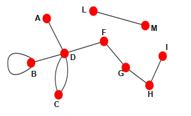
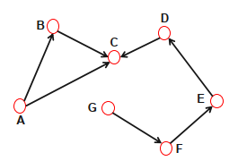

## Slide 6: Matriks Ketetanggaan (Adjacency Matrix)

**Isi slide:**

- Sebuah graf dapat direpresentasikan sebagai matriks ketetanggaan.
- 0
- 1
- 0
- 0
- 1
- 0
- 0
- 1
- 1
- 0
- 0
- 0
- 0
- 1
- 0
- 0
- 0
- 0
- 0
- 0
- 0
- 0
- 1
- 1
- 0
- A =
- j
- i
- aij = 1 ⇔ (i, j) ∈ E
- 1
- 2
- 3
- 4
- 5

## Slide 7: Matriks Ketetanggaan untuk Graf Berarah dan Tak Berarah

**Isi slide:**

- 1
- 2
- 3
- 4
- 1
- 2
- 3
- 4
- 0
- 1
- 0
- 1
- 1
- 0
- 0
- 1
- 0
- 0
- 0
- 1
- 1
- 1
- 1
- 0
- 0
- 0
- 0
- 1
- 1
- 0
- 0
- 0
- 0
- 0
- 0
- 0
- 0
- 1
- 1
- 0
- Aij =
- Aij =
- A12
- A14
- Aij=1 jika ada tautan antara simpul i dan j
- Aij=0 jika simpul i dan j tidak terhubung satu sama lain.
- Perhatikan bahwa untuk graf tak berarah (kiri) matriksnya simetris.

## Slide 8: Graf Berbobot dan Tak Berbobot

**Isi slide:**

- Graf Tak Berbobot
- (tak berarah)
- Graf Berbobot
- (tak berarah)
- 1
- 2
- 3
- 4
- 1
- 2
- 3
- 4
- 0
- 1
- 1
- 0
- 1
- 0
- 1
- 1
- 1
- 1
- 0
- 0
- 0
- 1
- 0
- 0
- 0
- 2
- 0.5
- 0
- 2
- 0
- 1
- 4
- 0.5
- 1
- 0
- 0
- 0
- 4
- 0
- 0
- Aij =
- Aij =
- Contoh: jaringan jalan (jarak dalam mil)

## Slide 9: Graf Bipartit

**Isi slide:**

- Graf bipartit (atau bigraph) adalah graf yang simpulnya dapat dibagi menjadi dua himpunan saling lepas (disjoint sets) U dan V sedemikian sehingga setiap garis menghubungkan simpul di U dengan simpul di V; artinya, U dan V adalah himpunan independen.
- Contoh:
- jaringan film/aktor
- jaringan penyakit/gejala
- jaringan foto/tag di Flickr
- rekomendasi pelanggan/produk
- U
- V

## Slide 10: Atribut Simpul, Busur, dan Sisi (Vertex, Arc and Edge Attributes)

**Isi slide:**

- Simpul, busur, dan sisi dapat memiliki atribut.
- Contoh jaringan dengan atribut simpul (vertex) dan busur:
- pasangan meja makan asrama putri (Moreno, The Sociometry Reader, 1960)
- pilihan pertama dan kedua ditampilkan

**Aset & Diagram:**

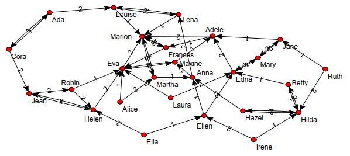

## Slide 11: Derajat (Degree)

**Isi slide:**

- Derajat: Jumlah
- C
- D
- (v)
- sisi yang bertetangga dengan v
- Derajat-masuk/
- In degree):
- C
- D
- in
- (v) =
- Σ
- |V|
- j=1, i≠j
- aji
- Derajat-keluar
- Out-degree:
- C
- D
- out
- (v) =
- Σ
- |V|
- j=1, i≠j
- aij
- A =
- 0
- 0
- 0
- 1
- 1
- 0
- 1
- 0
- 0
- 0
- 0
- 0
- 0
- 1
- 0
- 0
- j
- i
- 1
- 2
- 3
- 4
- C
- D
- (v2) = 3
- C
- D
- in
- (v2) = 1
- C
- D
- out
- (v2) = 2

## Slide 12: Contoh: Derajat Graf Tak Berarah dan Berarah

**Isi slide:**

- Tak Berarah
- Berarah
- Derajat: jumlah sisi yang terhubung dengan simpul.
- kA = 1
- kB = 4
- A
- B
- B
- C
- D
- A
- E
- F
- G
- Pada graf berarah kita dapat mendefinisikan derajat-masuk (in-degree) dan derajat-keluar (out-degree). Derajat (total) adalah jumlah derajat-masuk dan derajat-keluar.
- k
- C
- in
- = 2
- k
- C
- out
- = 1
- k
- C
- = 3
- Source: simpul dengan kin = 0 dan kout > 0
- Sink: simpul dengan kout = 0 dan kin > 0

## Slide 13: Distribusi Derajat

**Isi slide:**

- Merangkum derajat dari semua simpul (vertex).
- Representasi alternatif:
- Hitungan frekuensi simpul untuk setiap derajat
- P(k): peluang bahwa sebuah simpul yang dipilih secara acak memiliki derajat k

**Aset & Diagram:**

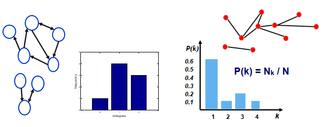

## Slide 14: Distribusi derajat (degree distribution) pada jaringan skala besar

**Isi slide:**

- sering kali mengikuti (secara perkiraan) hukum pangkat (power law).
- Power-Law Distributions

**Aset & Diagram:**

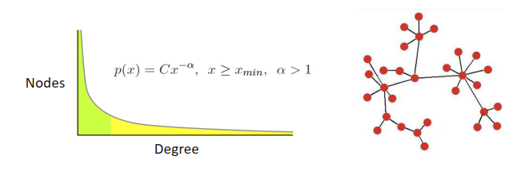

## Slide 15: Derajat Rata-rata(Average Degree)

**Isi slide:**

- Tidak berarah
- Berarah
- j
- i
- A
- B
- C
- D
- E
- F
- N – jumlah simpul dalam graf
- L – jumlah garis (sisi) dalam graf
- Peringatan: Derajat rata-rata bisa menyesatkan karena distribusi derajat yang menyerupai hukum pangkat (power-law).

**Aset & Diagram:**

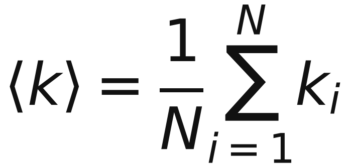
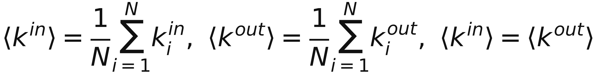
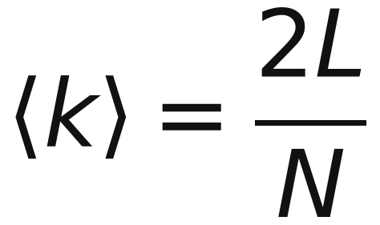

## Slide 16: Kepadatan Graf (Graph Density)

**Isi slide:**

- Jumlah maksimal koneksi yang dapat ada di antara simpul:
- graf berarah
- Lmaks = N*(N−1)
- karena setiap N simpul dapat terhubung ke (N−1) simpul lainnya
- graf tidak berarah
- Lmaks = N*(N−1)/2
- karena sisi tidak berarah, setiap sisi dihitung satu kali saja
- Berapa bagian yang ada?
- Kepadatan = L / Lmaks
- Contoh: dari 12 kemungkinan koneksi, sebuah graf bisa memiliki 1, sehingga kepadatannya 11/12 = 0,917.

## Slide 17: Contoh: Kepadatan Graf

**Isi slide:**

- Kepadatan: tingkat keterhubungan, yaitu jumlah sisi yang ada dalam proporsi terhadap jumlah sisi yang mungkin
- G=(V,E)
- 1
- 2
- 3
- 4

**Aset & Diagram:**

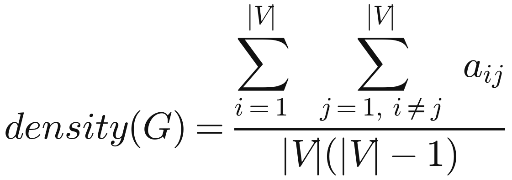
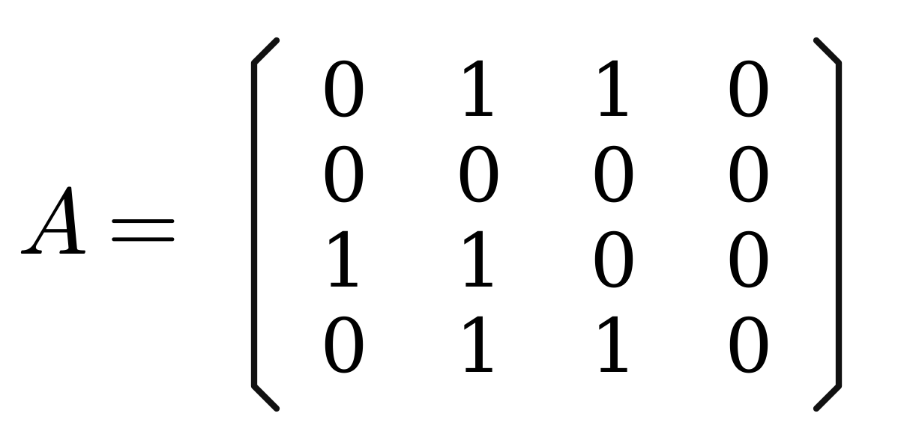
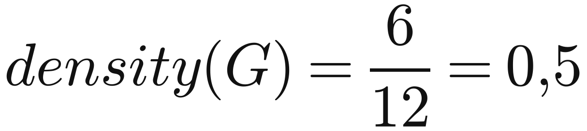

## Slide 18: Koefisien Klasterisasi

**Isi slide:**

- Kepadatan koneksi di antara teman-teman seseorang.
- Berapa bagian dari tetangga Anda yang saling terhubung?
- Koefisien klasterisasi adalah semacam ukuran kepadatan “lokal”
- ki jumlah sisi (tak berarah) di antara tetangga Vi
- di derajat simpul Vi
- Ci berada dalam [0,1]
- C = 0
- C = 0,5
- C = 1
- Tidak ada satu pun dari 6 pasang itu yang berteman.
- k = 0
- C = 0 / 6 = 0
- Clustering coefficient mengukur seberapa erat keterhubungan antar tetangga dari suatu simpul (node) dalam graf. Dengan kata lain, ia menjawab pertanyaan: "Apakah teman-teman dari node 𝑖juga saling berteman satu sama lain?"

**Aset & Diagram:**

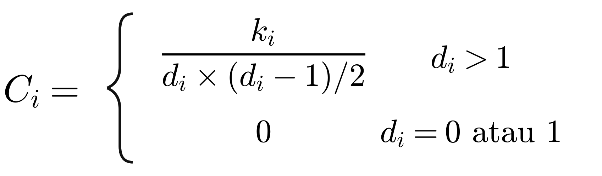
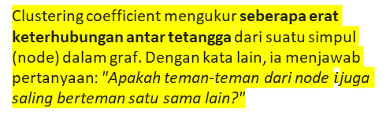

## Slide 19: Contoh: Koefisien Klasterisasi

**Isi slide:**

- 1
- 2
- 3
- 4
- 5
- 6
- 7
- 8
- 9
- d6 = 4, N6 = {4, 5, 7, 8}
- k6 = 4 karena e(4,5), e(5,7), e(5,8), e(7,8)
- C6 = 4/(4*3/2) = 2/3
- Koefisien Klasterisasi Rata-rata
- C = (C1 + C2 + … + Cn) / N
- C = 0,61 untuk jaringan di sebelah kiri
- Pada graf acak, rata-rata koefisien klasterisasi yang diharapkan adalah 0,19
- → graf memiliki struktur komunitas tertentu

**Aset & Diagram:**

## Slide 20: Atribut Simpul

**Isi slide:**

- simpul dijelaskan oleh atribut pada banyak jaringan dunia nyata
- mis. jaringan sosial dengan atribut simpul berupa nama, tanggal lahir, alamat, minat, tipe …
- menggabungkan atribut-atribut ini dengan ukuran seperti derajat sering kali mengungkap wawasan yang menarik
- mis. jumlah teman di Facebook dalam kaitannya dengan usia dan lokasi

**Aset & Diagram:**

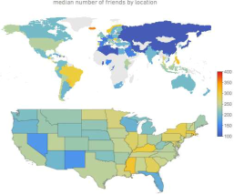
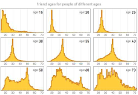
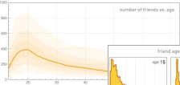

## Slide 21: Lintasan

**Isi slide:**

- Lintasan adalah serangkaian simpul di mana setiap simpul bertetangga dengan simpul berikutnya.
- Pi0,in dengan panjang n antara simpul i0 dan in adalah kumpulan terurut dari n+1 simpul dan n garis.
- Sebuah lintasan dapat berpotongan dengan dirinya sendiri dan melewati garis yang sama berulang kali. Setiap kali sebuah garis dilewati, garis itu dihitung secara terpisah.
- Lintasan yang sah pada graf di sebelah kanan:
- A B C B C A D E E B A  (panjang=11)
- Pada graf berarah, lintasan hanya boleh mengikuti arah busur.
- A
- B
- C
- D
- E

**Aset & Diagram:**

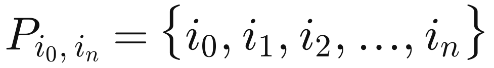
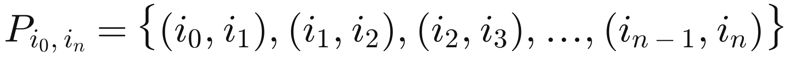

## Slide 22: Jalur Terpendek / Jarak

**Isi slide:**

- A
- B
- C
- D
- A
- B
- C
- D
- Jarak (jalur terpendek, jalur geodesik) antara dua simpul didefinisikan sebagai jumlah sisi sepanjang jalur terpendek yang menghubungkan keduanya.
- Jika kedua simpul tidak terhubung, jaraknya tak hingga.
- Pada graf berarah, setiap jalur harus mengikuti arah busur. Jadi, pada digraf, jarak dari simpul A ke B (pada jalur AB) umumnya berbeda dari jarak dari simpul B ke A (pada jalur BCA).

## Slide 23: Diameter Jaringan dan Jarak Rata-rata

**Isi slide:**

- Diameter
- dmaks  jarak maksimum antara sepasang simpul mana pun dalam graf.
- Perhatian: Sebagian orang memakai istilah “diameter” untuk menyatakan panjang lintasan terpendek rata-rata.
- Jarak Rata-rata / Panjang Lintasan Terpendek Rata-rata
- <d>  untuk graf terhubung:
- dengan dij adalah jarak dari simpul i ke simpul j dan N adalah jumlah simpul.
- –  Panjang lintasan terpendek rata-rata membedakan jaringan yang mudah dinavigasi dari jaringan yang rumit dan tidak efisien (mis. untuk informasi atau transportasi massal).

**Aset & Diagram:**

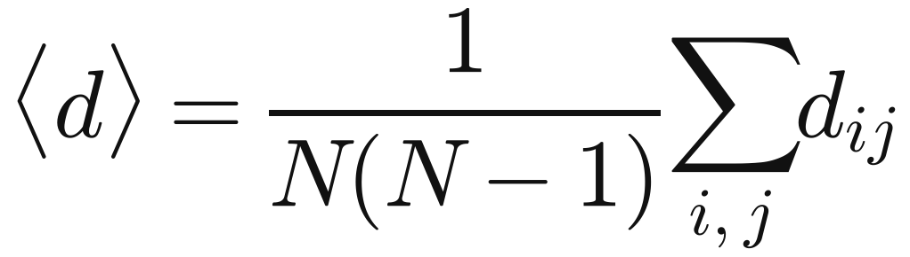

## Slide 24: Contoh: Diameter

**Isi slide:**

- Diameter sebuah graf adalah jarak maksimum antara dua simpul mana pun (“lintasan terpendek terpanjang”).
- 1
- 2
- 3
- 4
- 5
- 6
- 7
- 8
- 9
- 0
- Diameter: 5 – karena lintasan (7,2), (2,6), (6,3), (3,4), (4,5)

## Slide 25: Latihan: Mengkarakterisasi Graf

**Isi slide:**

- Silakan hitung ukuran-ukuran berikut untuk graf di bawah ini:
- 1.
- Diameter dmaks
- 2.
- Distribusi derajat (degree
- 3.
- Koefisien klasterisasi C2 dan C3
- 3
- 4
- 1
- 2

## Slide 26: Solusi: Karakteristik Graf

**Isi slide:**

- dmaks = 2 karena lintasan terpendek antara 3 dan 1 serta antara 4 dan 1
- Distribusi derajat:

**Aset & Diagram:**

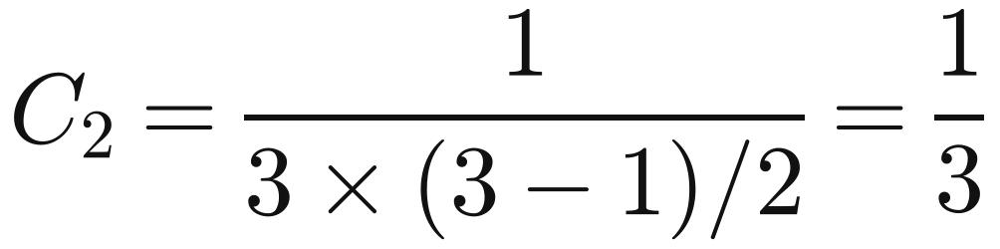
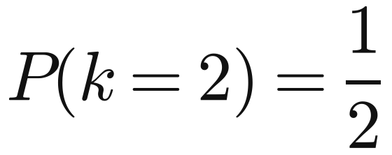
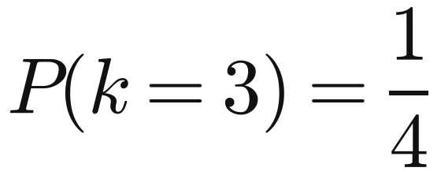
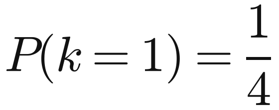
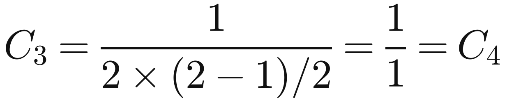

## Slide 27: 2. Prominensi

**Isi slide:**

- Siapa aktor yang “paling penting” dalam sebuah jaringan sosial?
- Sentralitas
- Seorang aktor sentral adalah aktor yang terlibat dalam banyak sisi.
- Arah sisi tidak dipertimbangkan.
- Prestise
- Seorang aktor berprestise adalah aktor yang menjadi sasaran banyak busur.
- Arah busur dipertimbangkan.
- Kemungkinan interpretasi
- –   Sentralitas: “kekuatan sosial” seorang aktor
- –   Prestise: “reputasi” seorang aktor

## Slide 28: 2. Prominensi

**Isi slide:**

- 2.1 Sentralitas
- Simpul mana yang paling ‘sentral’?
- Dihitung untuk graf tak berarah
- Definisi ‘sentral’ bervariasi menurut konteks / tujuan:
- Ukuran lokal:
- Sentralitas derajat (degree centrality)
- Relatif terhadap seluruh jaringan:
- Sentralitas kedekatan (closeness centrality)
- Sentralitas keantaraan (betweenness centrality)
- Seberapa merata sentralitas terdistribusi di antara simpul?
- Sentralisasi (centralization)

## Slide 29: Sentralitas Derajat (Degree Centrality

**Isi slide:**

- Gagasan: Ukur sentralitas sebagai jumlah sisi ke simpul-simpul lain dalam graf.
- Menjawab pertanyaan: Berapa banyak orang yang dapat dijangkau atau dipengaruhi seseorang secara langsung?
- Degree Centrality
- CD(ni) = d(ni)
- Hanya berfokus pada pilihan langsung (panjang lintasan=1)
- Normalized Degree Centrality
- C’D(ni) = d(ni) / (N−1)
- Derajat dibagi derajat maksimal yang mungkin, yaitu jumlah simpul – 1
- Proporsi dari semua simpul yang bertetangga dengan ni
- 1
- 1
- 1
- 1
- 1
- 5

## Slide 30: Contoh: Degree Centrality

**Isi slide:**

- Pada graf tak berarah, sentralitas CD(v) dari sebuah simpul adalah derajatnya.
- Normalisasi:
- 1
- 2
- 3
- 4

**Aset & Diagram:**

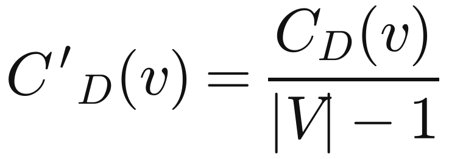
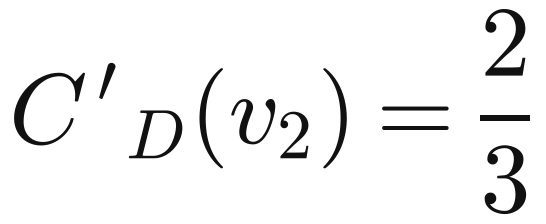
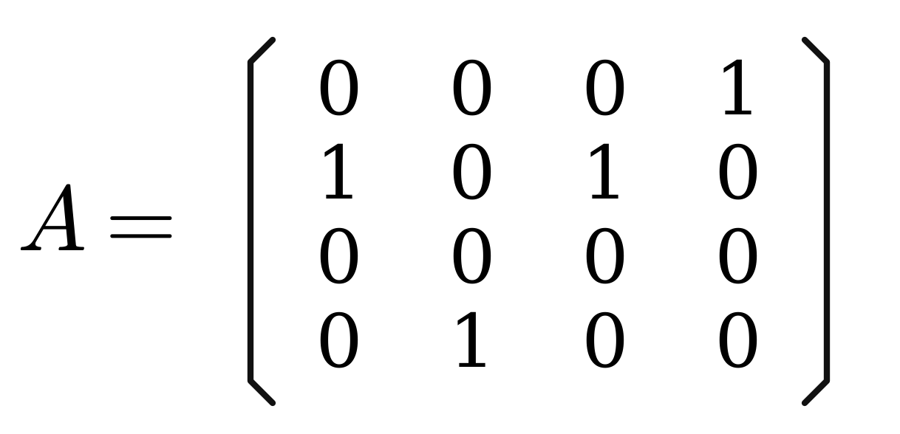

## Slide 31: Contoh: Degree Centrality Ternormalisasi C’D

**Isi slide:**

- 1
- 0,2
- 0,2
- 0,2
- 0,2
- 0,2
- 0,33
- 0,33
- 0,50
- 0,33
- 0,50
- 0,33
- 0,33
- 0,25
- 0,50
- 0,50
- 0,50
- 0,25

## Slide 32: Sentralisasi

**Isi slide:**

- Seberapa besar variasi skor sentralitas di antara simpul-simpul (vertex)?
- Rumus umum Freeman untuk sentralisasi:
- CD =
- Σ
- g
- i=1
- [CD(n*) − CD(i)]
- (N − 1)(N − 2)
- nilai maksimum dalam jaringan
- jumlah simpul tanpa simpul pusat
- selisih derajat maksimum yang mungkin
- hitung jumlah selisih sentralitas antara simpul paling sentral dalam graf dan semua simpul lainnya;
- bagi besaran ini dengan jumlah selisih terbesar secara teoretis pada graf mana pun dengan derajat yang sama (graf berbentuk bintang).
- Rentang nilai [0,1]

## Slide 33: Contoh: Degree Centralization

**Isi slide:**

- 5
- 1
- 1
- 1
- 1
- 1
- 1
- 2
- 2
- 2
- 1
- 2
- 2
- 3
- 2
- 3
- 2
- 2
- CD = 1,0
- CD = 0,167
- CD = 0,167

## Slide 34: Contoh: Sentralisasi Derajat

**Isi slide:**

- 1
- 1
- 1
- 1
- 1
- 5
- CD = 1,0
- 1
- 2
- 2
- 2
- 1
- CD = 0,167
- 2
- 2
- 2
- 2
- 3
- 3
- 2
- CD = 0,167
- Angka di dalam simpul menunjukkan derajat simpul tersebut.

## Slide 35: import networkx as nx

**Isi slide:**

- import matplotlib.pyplot as plt
- def sentralisasi_derajat(G):
- """Sentralisasi derajat Freeman:
- sum[C_D(n*) - C_D(i)] / ((N-1)(N-2))
- """
- N = G.number_of_nodes()
- derajat = dict(G.degree())
- maks = max(derajat.values())
- pembilang = sum(maks - d for d in derajat.values())
- penyebut = (N - 1) * (N - 2)
- return pembilang / penyebut
- def gambar(G, pos, ax, judul):
- derajat = dict(G.degree())
- nx.draw_networkx_edges(G, pos, ax=ax, edge_color="gray")
- nx.draw_networkx_nodes(
- G, pos, ax=ax,
- node_size=[300 + 250 * d for d in derajat.values()],
- node_color="#6cb4ee", edgecolors="#1f3b73",
- )
- nx.draw_networkx_labels(G, pos, labels=derajat, ax=ax, font_size=10, font_weight="bold")
- ax.set_title(f"{judul}\nC_D = {sentralisasi_derajat(G):.3f}", fontsize=12)
- ax.axis("off")
- # Graf bintang: 1 pusat + 5 simpul tepi (N = 6)
- bintang = nx.star_graph(5)
- pos_bintang = nx.spring_layout(bintang, seed=42)
- # Graf garis: 5 simpul (N = 5)
- garis = nx.path_graph(5)
- pos_garis = {i: (i, 0) for i in garis.nodes()}
- fig, axes = plt.subplots(1, 2, figsize=(11, 4))
- gambar(bintang, pos_bintang, axes[0], "Graf Bintang (N = 6)")
- gambar(garis, pos_garis, axes[1], "Graf Garis (N = 5)")
- plt.tight_layout()
- plt.savefig("sentralisasi_derajat.png", dpi=150)
- plt.show()

## Slide 36: Ketika derajat bukan segalanya

**Isi slide:**

- Dengan cara apa derajat gagal menangkap sentralitas pada graf-graf berikut?
- 1
- 2
- 2
- 2
- 1
- 2
- 2
- 2
- 2
- 3
- 3
- 2
- Dalam konteks apa derajat mungkin tidak cukup untuk menggambarkan sentralitas?
- Kemampuan menjembatani (broker) antar kelompok
- Kemungkinan informasi yang berasal dari mana pun dalam jaringan sampai kepada Anda
- Kasus penggunaan ini memerlukan ukuran yang relatif terhadap bagian jaringan lainnya.

## Slide 37: Sentralitas Keperantaraan

**Isi slide:**

- Intuisi: Berapa banyak pasangan individu yang harus melewati Anda agar dapat saling menjangkau dalam jumlah lompatan (hop) minimum?
- Asumsi:
- Interaksi antara dua aktor yang tidak bertetangga dapat bergantung pada aktor-aktor lain dalam himpunan aktor, terutama aktor yang berada pada jalur di antara kedua simpul tersebut.
- Aktor yang berada “di tengah” di antara aktor lain memiliki kendali tertentu atas jalur dalam jaringan – “pengaruh antarpribadi”.
- Siapa yang memiliki sentralitas keperantaraan lebih tinggi, X atau Y?
- X
- Y
- Y
- X

## Slide 38: Sentralitas Keperantaraan: Definisi

**Isi slide:**

- CB(i) =
- Σ
- j<k
- gjk(i) / gjk
- Dengan gjk = jumlah jalur terpendek yang menghubungkan j dan k, dan gjk(i) = jumlah di antaranya yang dilalui aktor i.
- Biasanya dinormalisasi dengan membaginya dengan nilai teoretis maksimum untuk C′B(i):
- C′B(i) = CB(i) /[(n − 1)(n − 2)/2]
- jalur bersifat simetris
- jumlah simpul tanpa simpul itu sendiri
- jumlah pasangan simpul tanpa simpul itu sendiri = jalur terpendek untuk setiap simpul

## Slide 39: Contoh: Sentralitas Keperantaraan pada Jaringan Sederhana

**Isi slide:**

- Versi tanpa normalisasi:
- 0
- A
- 3
- B
- 4
- C
- 3
- D
- 0
- E
- A tidak berada di antara dua simpul lain mana pun
- B berada di antara A dan 3 simpul lain: C, D, dan E
- C berada di antara 4 pasang simpul (A,D), (A,E), (B,D), (B,E)
- Perhatikan bahwa tidak ada jalur alternatif bagi pasangan-pasangan ini, sehingga C mendapat nilai penuh.

## Slide 40: Sentralitas Keperantaraan pada Jaringan Sederhana

**Isi slide:**

- Versi tanpa normalisasi:
- 0
- 3,5
- 1
- 1
- 0,5
- A
- B
- C
- D
- E
- Mengapa C dan D masing-masing memiliki keperantaraan 1?
- Keduanya sama-sama berada pada jalur terpendek untuk pasangan (A,E) dan (B,E), sehingga harus berbagi nilai: ½ + ½ = 1
- Dapatkah Anda mencari tahu mengapa B memiliki keperantaraan 3,5 sedangkan E memiliki keperantaraan 0,5?

## Slide 41: Sentralitas Kedekatan

**Isi slide:**

- Ukuran ini berfokus pada seberapa dekat seorang aktor dengan semua aktor lain dalam jaringan
- misalnya untuk menyebarkan informasi atau berinteraksi dengan orang lain
- atau untuk dijangkau oleh informasi yang menyebar melalui jaringan
- Sentralitas kedekatan didasarkan pada panjang rata-rata jalur terpendek antara sebuah simpul dan semua simpul dalam graf.
- Sentralitas Kedekatan:
- Cc(i) =
- [
- Σ
- N
- j=1
- d(i,j)
- ]
- −1
- Sentralitas Kedekatan Ternormalisasi:
- C′c(i) = Cc(i)(N − 1)
- bentuk bintang: setiap simpul berjarak satu dari simpul pusat

## Slide 42: Contoh: Sentralitas Kedekatan Ternormalisasi

**Isi slide:**

- 0,4
- A
- 0,57
- B
- 0,67
- C
- 0,57
- D
- 0,4
- E
- C′c(A) =
- [
- Σ
- N
- j=1
- d(A,j)
- N − 1
- ]
- −1
- =
- [
- 1 + 2 + 3 + 4
- 4
- ]
- −1
- =
- [
- 10
- 4
- ]
- −1
- = 0,4
- Contoh lain:
- 0,56
- 0,56
- 0,56
- 0,56
- 0,56
- 1
- 0,4
- 0,4
- 0,4
- 0,4
- 0,55
- 0,55
- 0,6

## Slide 43: Korelasi Metrik Sentralitas

**Isi slide:**

- Secara umum, berbagai metrik sentralitas yang berbeda akan berkorelasi positif.
- Jika tidak demikian, kemungkinan ada sesuatu yang menarik pada simpul tersebut.
- sentralitas kedekatan ditunjukkan dengan warna
- derajat ditunjukkan dengan ukuran
- sentralitas keperantaraan ditunjukkan dengan warna
- derajat ditunjukkan dengan ukuran

## Slide 44: 3.2 Prestise

**Isi slide:**

- Prestise merujuk pada kelas metrik keunggulan (prominence) yang memperhitungkan arah busur (arc).
- Diterjemahkan menjadi: pilihan yang diterima
- Contoh ketika arah itu penting:
- suara dalam pemilu
- hyperlink di WWW
- suka (like) di TikTok
- sitasi makalah ilmiah
- Contoh ketika “prestise” mungkin bukan kata yang tepat:
- ketidaksukaan (dislike)
- ketidakpercayaan

## Slide 45: Prestise Derajat / Popularitas

**Isi slide:**

- Ukuran prestise tingkat simpul yang paling sederhana: derajat masuk (in-degree)
- Gagasannya: aktor yang berprestise cenderung menerima banyak nominasi atau pilihan
- makalah yang dikutip oleh banyak pihak lain memiliki prestise tinggi
- orang yang dinominasikan banyak pihak untuk sebuah penghargaan memiliki prestise tinggi
- Ukuran lokal karena hanya tetangga yang diperhitungkan.
- Prestise Derajat / Popularitas
- PD(ni) = din(ni)
- Prestise Derajat Ternormalisasi
- C′D(ni) = din(ni) / N−1
- Derajat masuk dibagi derajat masuk maksimum yang mungkin
- Proporsi semua simpul yang memilih ni (mis. proporsi suara)

## Slide 46: Domain Masukan

**Isi slide:**

- Prestise derajat hanya menghitung aktor yang berdekatan langsung dengan aktor ni, tetapi kita mungkin juga ingin memperhitungkan pilihan tidak langsung.
- Domain masukan (input domain) dari sebuah simpul dalam jaringan berarah adalah jumlah atau persentase semua simpul lain yang terhubung dengan sebuah jalur ke simpul ini.
- Disebut juga domain pengaruh, yang masuk akal misalnya untuk kasus penggunaan mengikuti (follow) akun di Twitter.

## Slide 47: Prestise Kedekatan (Proximity)

**Isi slide:**

- Ukuran prestise berdasarkan jarak dalam domain masukan.
- Nominasi (pilihan) langsung harus dihitung lebih besar daripada yang tidak langsung
- Nominasi dari tetangga derajat kedua harus dihitung lebih besar daripada tetangga derajat ketiga
- Pp(vi) =
- proporsi semua simpul yang berada dalam domain masukan i
- jarak rata-rata dari i ke simpul dalam domain masukan
- PP(v) =
- |Iv|/(|V| − 1)
- (∑i∈Iv dist(i,v) ) / |Iv|
- Contoh:
- v10
- (0,00)
- v9
- (0,11)
- v8
- (0,15)
- v7
- (0,17)
- v1
- (0,50)
- v3
- (0,33)
- v4 (0,00)
- v5 (0,00)
- v6 (0,00)
- v2 (0,00)

## Slide 48: Contoh: Prestise Kedekatan Simpul v1

**Isi slide:**

- PP(v) =
- |Iv|/(|V| − 1)
- (∑i∈Iv dist(i,v) ) / |Iv|
- Contoh:
- v10
- (0,00)
- v9
- (0,11)
- v8
- (0,15)
- v7
- (0,17)
- v1
- (0,50)
- v3
- (0,33)
- v4 (0,00)
- v5 (0,00)
- v6 (0,00)
- v2 (0,00)
- Iv1 = {v2, v3, v4, v5, v6, v7, v8, v9, v10}
- PP(v1) =
- 9/9
- (1 + 1 + 2 + 2 + 2 + 1 + 2 + 3 + 4)/9
- = 0,5

## Slide 49: Contoh: Prestise Kedekatan Simpul v8

**Isi slide:**

- PP(v) =
- |Iv|/(|V| − 1)
- (∑i∈Iv dist(i,v) ) / |Iv|
- Contoh:
- v10
- (0,00)
- v9
- (0,11)
- v8
- (0,15)
- v7
- (0,17)
- v1
- (0,50)
- v3
- (0,33)
- v4 (0,00)
- v5 (0,00)
- v6 (0,00)
- v2 (0,00)
- Iv8 = {v9, v10}
- PP(v8) =
- 2/9
- (2 + 1)/2
- = 0,148148148

## Slide 50: Rank Prestise dan PageRank

**Isi slide:**

- Rank Prestise
- Ukuran prestise yang mempertimbangkan prestise dari aktor yang melakukan “pemilihan”.
- Anda lebih berprestise jika memiliki banyak orang berprestise lain dalam domain masukan Anda.
- PR(i) =
- Σ
- (j,i)∈E
- PR(j)
- j: simpul dalam domain masukan i
- PageRank
- Variasi dari rank prestise di mana prestise sebuah simpul pemilih dibagi di antara semua target tautannya.
- PPR(i) =
- Σ
- (j,i)∈E
- PPR(j) / Dout(j)
- Keunggulan PageRank dalam konteks pencarian
- sulit dimanipulasi dengan tautan SPAM
- skor tidak bergantung pada kueri mesin pencari yang sebenarnya
- Perhitungan skor PageRank: lihat Bing Liu: Web Data Mining, Bab 7.3

